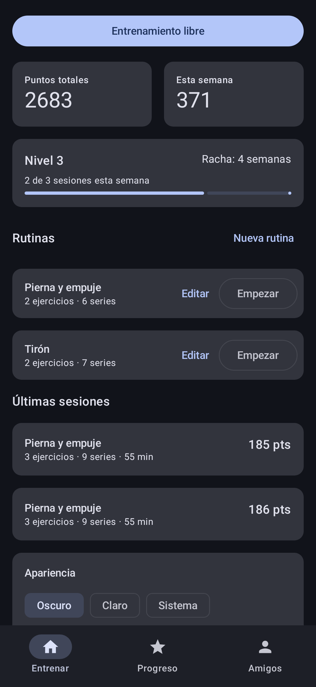
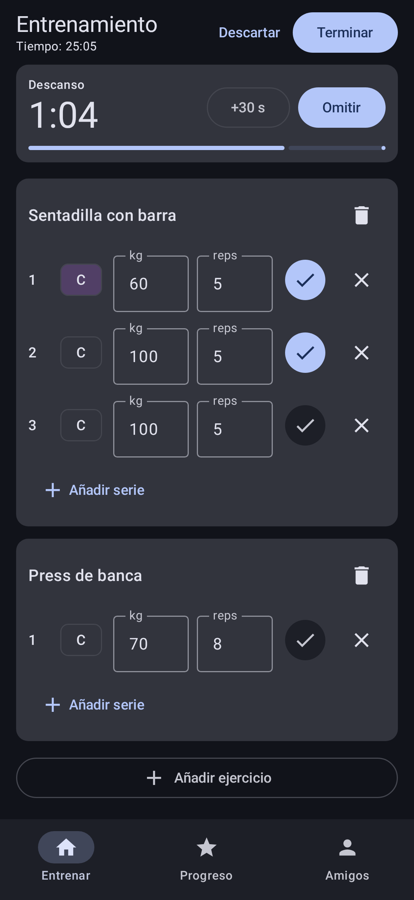
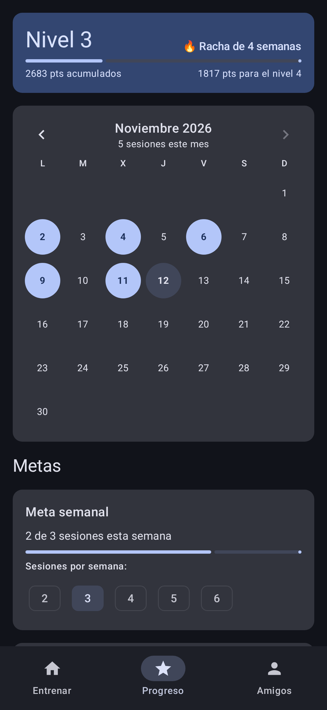
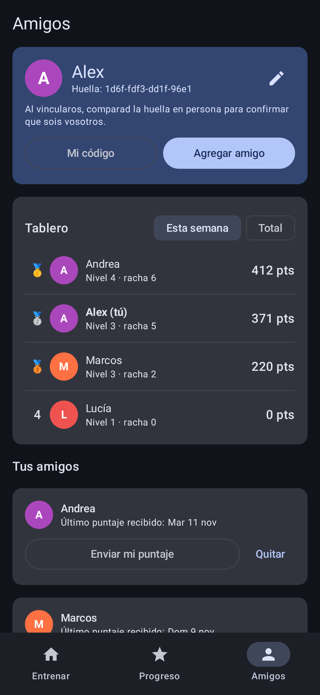
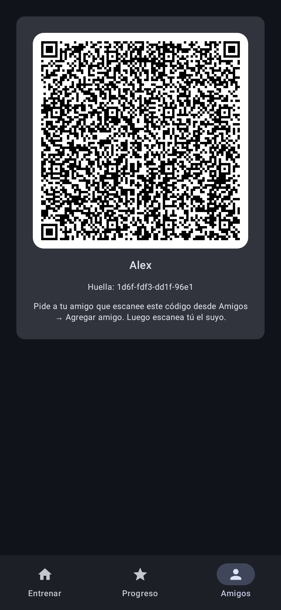
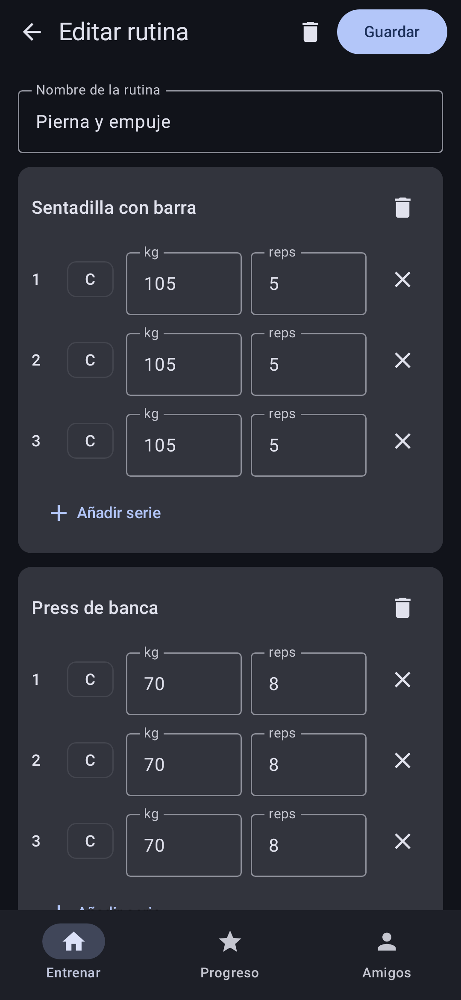

# GymTracker

App Android para registrar entrenamientos de gimnasio con metas y puntaje, **sin servidores**:
los datos viven cifrados en el teléfono y el puntaje se comparte solo con amigos vinculados
en persona, mediante paquetes cifrados de extremo a extremo.

Documentos de diseño:

- [PLAN.md](PLAN.md): visión, funciones, arquitectura, tecnologías y fases.
- [docs/EVENTOS.md](docs/EVENTOS.md): esquema de eventos v1 (registro solo-anexar, firmado).
- [docs/PUNTAJE_V1.md](docs/PUNTAJE_V1.md): fórmula de puntaje v1.

## Módulos

```
domain/   Kotlin/JVM puro. Modelos, eventos, proyecciones y motor de puntaje. Sin Android.
crypto/   Kotlin/JVM puro. Identidad Ed25519/X25519, firma, cifrado de paquetes (BouncyCastle).
data/     Android. Room + SQLCipher, sellado de secretos con Android Keystore. Implementa EventLog.
sync/     Android. Identidad local, construcción/recepción de paquetes, transportes (Nearby, archivo).
app/      Android. UI en Jetpack Compose + Hilt.
```

Dependencias: `app → sync → data → domain`, `sync → crypto → domain`. Toda la lógica de negocio
es testeable en JVM sin emulador.

## Requisitos

- JDK 17 o superior (probado con 21).
- Android SDK con `platforms;android-37.0` y `build-tools;37.0.0`. Indicar la ruta en
  `local.properties` (`sdk.dir=...`) o con la variable `ANDROID_HOME`.
- Gradle lo descarga el wrapper (9.9). AGP 9.5 con Kotlin integrado.

## Comandos

```bash
./gradlew :domain:test :crypto:test     # pruebas de dominio y criptografía (rápidas, solo JVM)
```

```bash
./gradlew :app:assembleDebug            # APK en app/build/outputs/apk/debug/
```

```bash
./gradlew test                          # todas las pruebas unitarias
```

```bash
./gradlew :app:updateDebugScreenshotTest   # renderiza las @Preview en JVM, sin emulador
```

Las capturas de referencia quedan en `app/src/screenshotTestDebug/reference/` y
`validateDebugScreenshotTest` las compara en CI para detectar regresiones visuales.

## Cómo luce hoy

| Inicio con rutinas | Entrenamiento con descanso | Progreso |
|---|---|---|
|  |  |  |

| Amigos y tablero | Mi código | Editor de rutina |
|---|---|---|
|  |  |  |

Más capturas en [docs/capturas](docs/capturas), incluida la pantalla de Progreso completa.

## Temporizador de descanso

Al marcar una serie de trabajo arranca el descanso (60/90/120/180 s configurables). Vive en un
servicio en primer plano (`app/.../timer/RestTimerService.kt`) para seguir corriendo con la app en
segundo plano o la pantalla apagada. La notificación muestra la cuenta regresiva con el cronómetro
del sistema y ofrece **+30 s** y **Omitir**; al llegar a cero avisa con sonido y vibración.
El estado se persiste, así que sobrevive a la muerte del proceso.

## Estado

- Fase 0 completada: módulos, esquema de eventos v1, fórmula de puntaje v1, identidad criptográfica, base de datos cifrada.
- Fase 1 completada: catálogo de 55 ejercicios + personalizados, registro de sesión con borrador persistente,
  temporizador de descanso en primer plano con notificación, historial semanal y detalle con desglose de puntos.
- Fase 2 completada: Progreso con nivel, calendario de asistencia, metas (semanal, fuerza y repeticiones),
  15 insignias, rutinas y CI con GitHub Actions.
- Fase 3 completada: amigos por QR o invitación, tablero, puntaje cifrado por archivo o por proximidad
  (Nearby) y apariencia oscura por defecto.
- Siguiente: Fase 4 (respaldo cifrado, onboarding y lanzamiento).

## CI y APK descargable

Cada push a `main` ejecuta [`.github/workflows/android.yml`](.github/workflows/android.yml): pruebas de dominio
y criptografía, validación de capturas y compilación del APK de depuración. El APK queda como artefacto
de la ejecución en la pestaña Actions durante 30 días.

Los APK de depuración se firman con `app/debug.keystore` (clave de depuración estándar, no secreta), así
cualquiera de ellos se instala encima del anterior sin perder datos.
